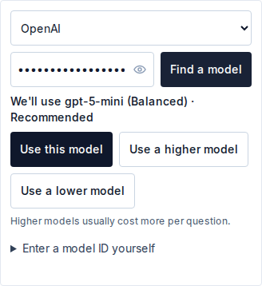
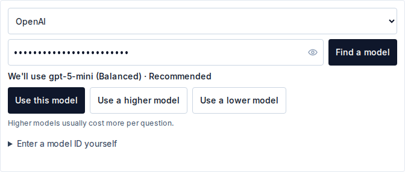
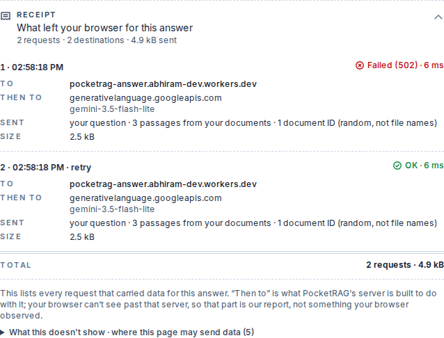
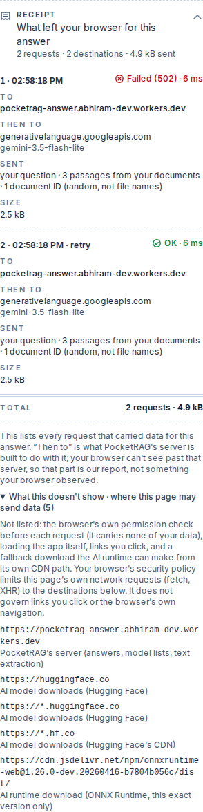
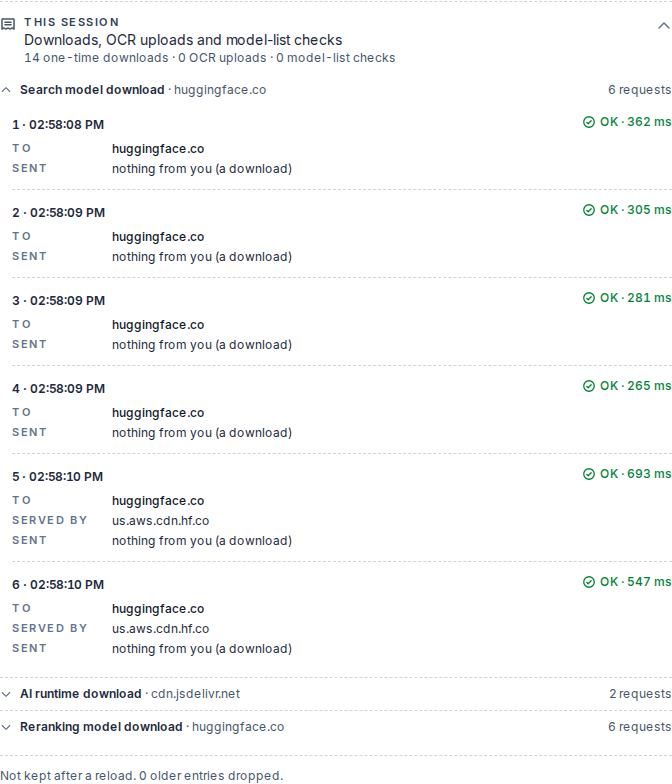
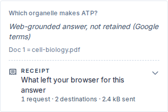
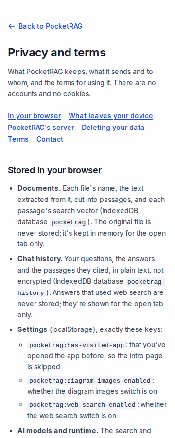
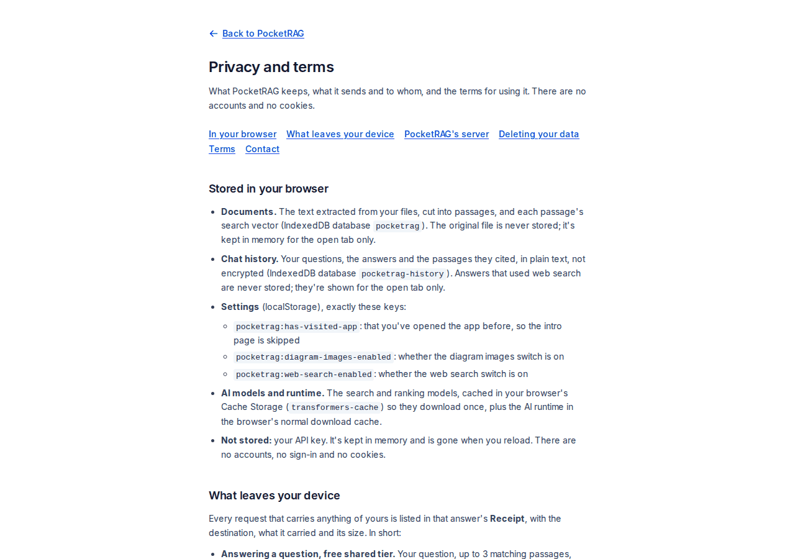

# PocketRAG

**Chat with your PDFs without uploading them.** PocketRAG reads, indexes and searches
your documents entirely in your browser, then sends your question and a few
matching passages to an AI model to compose a cited answer. Every answer comes with a
**Receipt**: each request that carried your data, where it went, what it carried and how
big it was, so you can check exactly what left your device instead of trusting a promise.
Use the free shared tier (Google Gemini) or bring your own key for Gemini, OpenAI,
Claude, Grok or OpenRouter.

**Live:** https://pocketrag.pages.dev · API: https://pocketrag-answer.abhiram-dev.workers.dev ·
[Privacy and terms](https://pocketrag.pages.dev/#privacy)

On the free shared tier, Google uses what's sent and the answers to provide, improve and
develop its products and machine-learning technologies, and human reviewers may read
them ([Gemini API Additional Terms](https://ai.google.dev/gemini-api/terms), "Unpaid
Services"). Use your own paid key to avoid that. The free shared tier isn't available in
the EEA, Switzerland or the UK (Google's terms); bring your own key there.

What an answer sends: your question, up to 3 retrieved passages, up to 3 earlier
questions and answers, random document IDs (never file names), and, only if you turn on
diagram images (off by default, free tier only), a page image when a question is about a
chart or diagram. It goes through PocketRAG's Cloudflare Worker to Google Gemini, or to
your own provider with your own key. The one exception to "files stay in the browser" is
the **Notes tab**: handwritten or scanned files are sent whole to Gemini for OCR, after a
consent prompt for every file. See [ARCHITECTURE.md](./ARCHITECTURE.md) for the full
privacy model.

## What it does

1. Drop in a PDF, or a photo/PDF of handwritten or scanned notes.
2. Ask a question, in plain English.
3. Get a grounded answer, with citations back to the source document and page.

PDF parsing, chunking, embedding, and retrieval on the Documents tab all run
client-side (WebGPU with a WASM fallback) — the answer request (your question, a few
retrieved passages, recent conversation turns) is the only request on that path that
carries your content. The first visit also downloads the embedding and reranking
models from Hugging Face and the ONNX runtime from jsDelivr; those carry nothing from
your documents but see your IP address. Two disclosed exceptions to "nothing leaves the browser": Notes-tab OCR
(above) and an opt-in toggle that sends a page image for diagram-aware questions,
default off — see Features below for both.

## Stack

- **Frontend:** React + Vite + TypeScript + Tailwind CSS v4 + Zustand
- **In-browser ML:** `@huggingface/transformers` (embeddings), `pdf.js` (PDF parsing),
  a client-side BM25 + cosine hybrid retriever with cross-encoder reranking
- **Storage:** IndexedDB (documents, chunks, embeddings, and chat history in plain
  text; web-grounded answers are never stored — never source bytes for OCR'd notes, see
  [ARCHITECTURE.md](./ARCHITECTURE.md))
- **Answer composition:** Cloudflare Worker (TypeScript) — shared-tier Gemini by
  default, or bring your own API key
- **Deployment:** Cloudflare Pages (frontend) + Cloudflare Workers (API), both live,
  continuously deployed — no separate build/install artifact to hand off

## Features

**Fully proven** (live-verified end-to-end against production, repeatedly, across the
Milestone 16 retest):
- Shared-tier Gemini answers, with citation-level groundedness checking
- Bring-your-own-key for **Gemini**, **OpenAI** and **Anthropic** — live model-list
  fetch, real grounded answers (Anthropic verified on production in v1.0.1)
- Hybrid retrieval (BM25 + embeddings via Reciprocal Rank Fusion) with cross-encoder
  reranking
- Multi-document library: bulk upload, per-document and cross-document retrieval,
  restore-on-reload, delete
- Multi-turn conversations with frozen `Doc N` citation labels and retrieval-query
  blending for follow-up questions
- Handwritten/scanned notes (photos and PDFs) via OCR, with per-file upload consent
- Diagram-aware Q&A — opt-in: sends the best-matching passage's page as an image when
  that page has a picture or the passage mentions a figure, chart or table
- Export a conversation as a PDF
- Receipts: every answer lists each request that carried your data — where it went,
  what it carried (question, passage and turn counts, never the text itself), its size
  and outcome, retries included — saved with the answer; a "This session" list covers
  model downloads, OCR uploads and model-list checks (see [Receipts](#receipts) below)
- Chat history: conversations saved in this browser and reopened on reload; delete one,
  all history, or everything (documents + history). Web-grounded answers are never
  stored
- Automatic model picker for your own key: PocketRAG reads the models your key can use
  and proposes one, with higher/lower steps (see [below](#bring-your-own-key-the-model-picker))
- Plain-language error handling (rate limits, invalid keys, network failures, a blocked
  model download with a retry) and Discord alerting on provider failures
- Rate-limit countdowns: when the free tier is busy, the answer shows when you can try
  again and the button waits for it, from the server's own numbers, never a guess
- Region notice: the free shared tier refuses the EEA, Switzerland and the UK (Google's
  terms) with a plain message pointing to your own key
- [Privacy and terms](https://pocketrag.pages.dev/#privacy) page, drift-tested against
  the code (storage keys, destinations, region list, providers)
- Light/dark mode (OS preference), responsive down to mobile

**Experimental** — shipped, but the success path isn't independently verifiable yet,
so treat these as best-effort, not proven:
- Bring-your-own-key for **Grok and OpenRouter** — fully implemented
  (same trust model as Gemini/OpenAI: key never persisted, request-scoped only), and
  their *failure* paths are live-verified (a bad key correctly produces a sanitized
  error, no key leak). Their *success* path — a real working answer — has no test key
  available yet to confirm.
- Web search grounding (Gemini's native "Grounding with Google Search," BYOK-Gemini
  only) — everything except the actual successful search call is live-verified
  (gating, UI, negative paths). The success call has consistently hit a free-tier
  Google Cloud quota limit (`429 RESOURCE_EXHAUSTED`) across every attempt so far;
  believed to require a billing-linked project to unlock.

## Bring your own key: the model picker

Choose a provider, paste your key, press **Find a model**. PocketRAG asks the provider
which models your key can use, ranks them, and proposes one: "We'll use … (Balanced) ·
Recommended". **Use a higher model** / **Use a lower model** step one rung at a time and
each step needs confirming again; the question box stays disabled until you confirm.
No model list is shown. The key and the chosen model stay in memory only.

- **How it ranks.** By model family and version, never by a hardcoded list
  (`src/lib/modelLadder.ts`): Gemini flash-lite < flash < pro, Claude haiku < sonnet <
  opus, OpenAI gpt-* nano < mini < full, Grok mini < full. Within a family it takes the
  newest version, stable over preview, the plain alias over a dated snapshot. A newer
  model in a known family is picked up with no code change; ids it doesn't recognise
  (other families, image/audio/embedding models, OpenAI's o-series) are left out.
- **"Recommended"** is the middle (Balanced) rung: a sensible default for answering
  questions over short passages. It isn't a claim that it's the best model.
- **What it can't know.** Prices, how capable a model is, and whether your account can
  actually use a listed model. Higher models usually cost more per question; check your
  provider's pricing.
- **When it can't help.** If nothing on the list qualifies, or the provider rejects a
  model when you ask a question, you can step down a rung (the picker reopens one rung
  lower, waiting for your confirmation) or type a model ID under **Enter a model ID
  yourself**. OpenRouter always uses `openrouter/auto`, which lets OpenRouter pick the
  model per question, so it has no higher/lower steps.

| 360 px | 1280 px |
| --- | --- |
|  |  |

The screenshots use a mocked model list.

## Receipts

Every answer has a **Receipt**: one row per request that carried your data for it,
retries included. Each row shows where the request went, what it carried, its size and
its outcome. The **This session** list covers everything else the page fetched: model
and runtime downloads, OCR uploads, model-list checks.

| A failed request and its retry | The limits, on a phone |
|---|---|
|  |  |

| This session: downloads, grouped | A restored web-grounded answer |
|---|---|
|  |  |

The screenshots come from a local build with PocketRAG's server mocked: it failed the first
answer on purpose. The model downloads in them are real.

### Check a receipt yourself

You don't have to take the Receipt's word for it. Your browser's developer tools show
the same requests.

1. Open https://pocketrag.pages.dev, open DevTools (F12) → **Network**, and tick
   **Preserve log**.
2. Add a PDF and ask a question. Expand the answer's **Receipt**.
3. In Network, find the `POST` to `pocketrag-answer.abhiram-dev.workers.dev/answer`.
   Compare it with the Receipt row:
   - **To:** the request's host.
   - **Sent:** the **Payload** tab (Firefox: **Request**) shows the JSON body. `question` is your question,
     `chunks` are the passages (count them), `history` holds the earlier turns, and
     `image` appears only when a page image was sent. The document IDs inside `chunks`
     are random, not file names. With your own key, `apiKey` is in the body too.
   - **Size:** the body's byte count. It's the `Content-Length` request header
     (**Headers** → Request Headers). DevTools' Size column shows the *response*, not
     what you sent. Receipts use decimal units (1 kB = 1000 B).
   - **Status:** the response status, so a failed try shows as its own row.
4. You may also see an `OPTIONS` request to the same URL just before the `POST`. That's
   the browser's CORS preflight. It carries none of your data, so it is deliberately not
   a Receipt row (the Receipt says so under "What this doesn't show").
5. To see the security policy that limits where the page can send data, click the first
   request (the page itself; reload if it's gone) → **Headers** → Response Headers →
   `content-security-policy`. Its `connect-src` lists the only hosts this page's own
   requests can reach. From a terminal:
   `curl -sI https://pocketrag.pages.dev | grep -i content-security-policy`.

**The automated check.** `e2e/step-c-csp.cjs` runs 15 flows (upload, questions, the
diagram path, OCR, BYOK model list, reload, deletes) in a real browser. It then
reconciles every cross-origin request the browser made against the Receipt and This
session rows on the page, and checks that each model's downloads match their rows. It
passes on Chromium and Firefox with 0 unmatched requests. It needs Playwright installed
globally:

```bash
npm run build && npx wrangler pages dev dist --port 8788 --compatibility-date=2026-07-29 &
NODE_PATH=$(npm root -g) node e2e/step-c-csp.cjs                    # Chromium
BROWSER=firefox NODE_PATH=$(npm root -g) node e2e/step-c-csp.cjs    # Firefox
```

PocketRAG's server is mocked in that test (no shared quota spent). The Hugging Face and
jsDelivr downloads are real.

**What this does not prove:**
- **"Then to"** (PocketRAG's server → Gemini or your provider) and the model name are the
  server's own report. Your browser can't see past that server.
- Size counts the request body only, not headers or preflights.
- Safari/WebKit is unverified.
- Links you click and the browser's own navigation aren't limited by the security policy
  and aren't listed. One fallback download the AI runtime can make on its own isn't
  listed either. See [SECURITY_REVIEW.md](./SECURITY_REVIEW.md) §8 for everything the
  ledger can't see and what limits it.

## Privacy and terms

[pocketrag.pages.dev/#privacy](https://pocketrag.pages.dev/#privacy), linked from the app
and landing footers: what's stored in your browser, what leaves it, what the server keeps
(per-IP daily counters, not hashed, expiring 24 hours after their last update; failure
logs without request bodies; Cloudflare Workers Logs' per-request records, kept up to 7
days), how to delete it, and short plain terms. Its lists are tested against the code,
so they fail the build's tests if they drift.

| 360 px | 1280 px |
| --- | --- |
|  |  |

## Known limitations

- **Safari/WebKit is unverified.** Tested on Chromium and Firefox only.
- **The Receipt can't see past PocketRAG's server.** "Then to" (the server's onward hop
  to Gemini or your provider) and the model name are the server's own report.
- **The free shared tier is rate-limited** (per IP per day, plus Google's own quota). When
  it's busy you get a countdown, or the raw matched passages, instead of an answer.
- **No free shared tier in the EEA, Switzerland or the UK.** Bring your own key there.
- Grok and OpenRouter answers are experimental: their failure paths are
  live-verified, a real successful answer isn't yet.
- Chat history is stored unencrypted in your browser.

## Roadmap

Deferred, not started:
- Streaming answers
- Toolchain bump (vitest, vite, wrangler)
- Pin the Hugging Face model revisions to commit SHAs instead of `main`
- Durable Objects for the rate-limit counters and the breaker (exact instead of
  best-effort)
- Safari verification

## Docs

- [ARCHITECTURE.md](./ARCHITECTURE.md) — codebase map, data flow, and the reasoning
  behind every non-obvious decision
- [SECURITY_REVIEW.md](./SECURITY_REVIEW.md) — the Milestone 15 security audit
- [TODO.md](./TODO.md) — project history and what's left
- [Privacy and terms](https://pocketrag.pages.dev/#privacy) — what's stored, what's
  sent, what the server keeps; source: `src/components/PrivacyPage.tsx`
